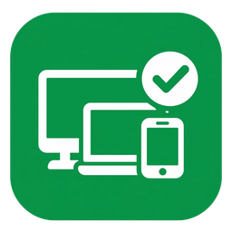
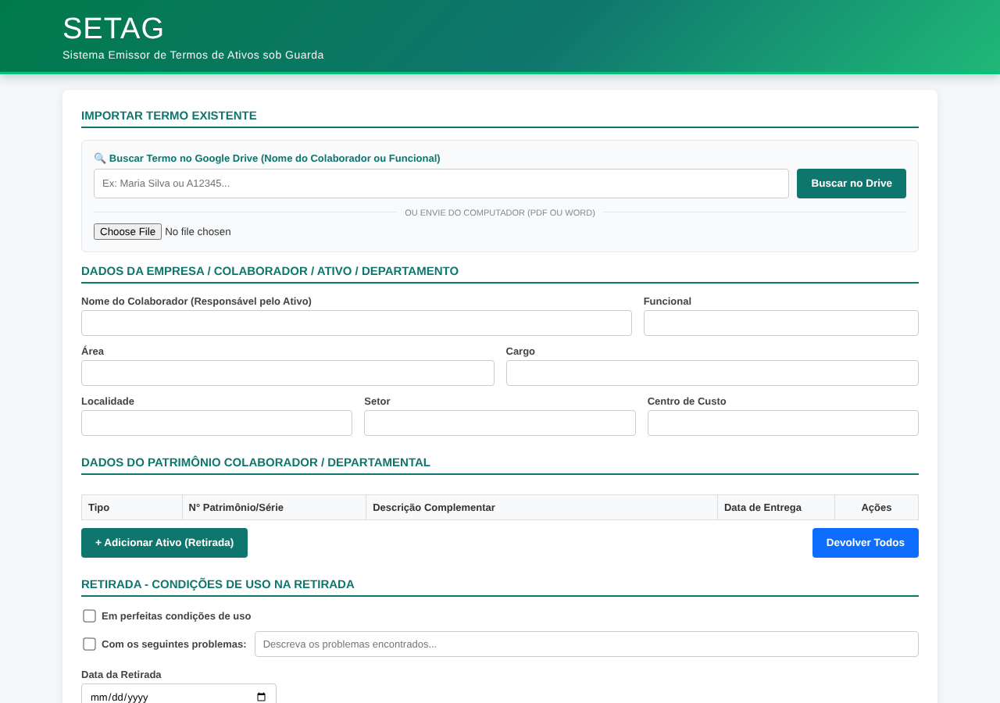
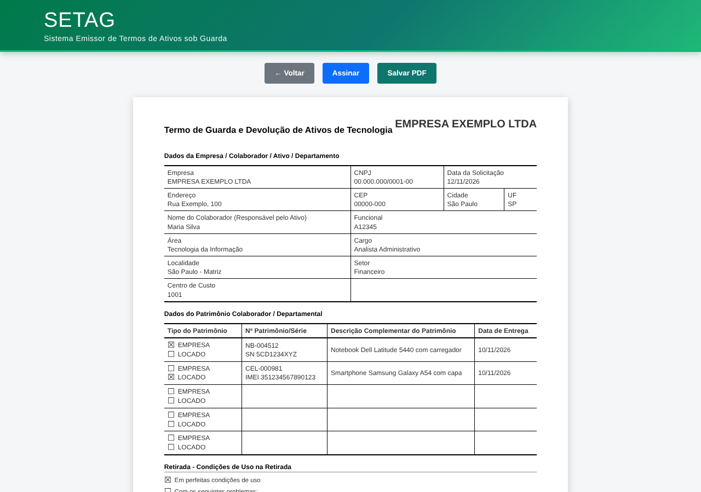

<p align="center">
  
</p>

<h1 align="center">SETAG</h1>
<p align="center"><strong>Sistema Emissor de Termos de Ativos sob Guarda</strong></p>

<p align="center">
  
  
  
  
</p>

Aplicação web feita em **Google Apps Script** para emitir e atualizar **termos de guarda e devolução de ativos de TI** (notebooks, celulares, periféricos) de forma padronizada, sem precisar montar o documento à mão no Word.

> Esta é uma **versão genérica** do projeto, criada para portfólio. Os dados de empresa que aparecem no código e nas imagens são fictícios.

---

## 💡 O problema

Na equipe de suporte, cada entrega ou devolução de equipamento exigia um termo de responsabilidade. Esses termos eram preenchidos manualmente no Word: copiar os dados do colaborador, listar os equipamentos, ajustar a formatação e exportar para PDF. Quando um colaborador recebia ou devolvia um item, era preciso abrir o termo antigo e refazer tudo.

## ✅ A solução

O SETAG reúne esse processo numa única tela:

- **Importa termos antigos** (PDF ou Word `.docx`), direto do Google Drive ou do computador, e preenche o formulário automaticamente com os dados do colaborador e dos ativos.
- **Busca termos no Google Drive** pelo nome do colaborador ou pela matrícula, somente dentro da pasta autorizada.
- **Controla retirada e devolução**: move ativos entre as listas de retirada e de devolução, com datas e condições de uso de cada um.
- **Gera o termo em PDF** com layout padronizado, já com o nome do arquivo no formato `Matrícula - Nome`.
- **Assinatura eletrônica na tela**, feita com o mouse ou o dedo (útil para quem não tem acesso a uma plataforma de assinatura digital).

## 🖼️ Telas

| Formulário | Termo gerado |
|---|---|
|  |  |

## 🧰 Tecnologias

- **Google Apps Script** (back-end: busca no Drive, controle de acesso à pasta, envio dos arquivos em Base64)
- **HTML, CSS e JavaScript** (interface, geração do termo, assinatura em `<canvas>`)
- **[PDF.js](https://mozilla.github.io/pdf.js/)** para ler o texto de termos em PDF
- **[JSZip](https://stuk.github.io/jszip/)** para ler termos em Word (`.docx`)

## 📁 Estrutura

```
setag/
├── src/
│   ├── Code.gs       # back-end (Apps Script)
│   └── Index.html    # interface e lógica do termo
└── docs/             # ícone e imagens do README
```

## 🚀 Como usar

1. Acesse [script.google.com](https://script.google.com) e crie um projeto novo.
2. Copie o conteúdo de `src/Code.gs` para o arquivo `Code.gs` do projeto.
3. Crie um arquivo HTML chamado **`Index`** e cole o conteúdo de `src/Index.html`.
4. No `Code.gs`, troque `COLE_AQUI_O_ID_DA_PASTA` pelo ID da pasta do Google Drive onde ficam os termos.
5. No início do `<script>` do `Index.html`, ajuste o objeto `CONFIG` com os dados da sua empresa (nome, CNPJ, endereço, logo, contato e código do formulário).
6. Clique em **Implantar → Nova implantação → App da Web** e defina quem pode acessar.

## ⚙️ Configuração

```js
const CONFIG = {
    empresa: {
        nome: "EMPRESA EXEMPLO LTDA",
        cnpj: "00.000.000/0001-00",
        endereco: "Rua Exemplo, 100",
        cep: "00000-000",
        cidade: "São Paulo",
        uf: "SP"
    },
    logoUrl: "",                         // vazio = mostra o nome da empresa
    rotuloPatrimonioProprio: "EMPRESA",  // o outro tipo de patrimônio é LOCADO
    contatoDevolucao: "(00) 00000-0000",
    codigoFormulario: "FR-0000-R00",
    iconeUrl: "https://raw.githubusercontent.com/dehsouzasou/setag/main/docs/icone.png"
};
```

## 🔒 Segurança e privacidade

- O back-end só lê arquivos **PDF ou Word** que estejam **dentro da pasta autorizada** no Drive (inclusive subpastas).
- O app roda dentro da conta Google de quem o implanta; nenhum dado é enviado para servidores de terceiros.
- Os termos contêm dados pessoais de colaboradores: restrinja o acesso ao app e à pasta apenas a quem precisa.

## 👩‍💻 Autora

**Débora de Souza Evangelista**: [LinkedIn](https://www.linkedin.com/in/dehsouzas)

Projeto criado por iniciativa própria para automatizar uma rotina da equipe de suporte de TI.

## 📄 Licença

Distribuído sob a licença MIT. Veja o arquivo [LICENSE](LICENSE).
